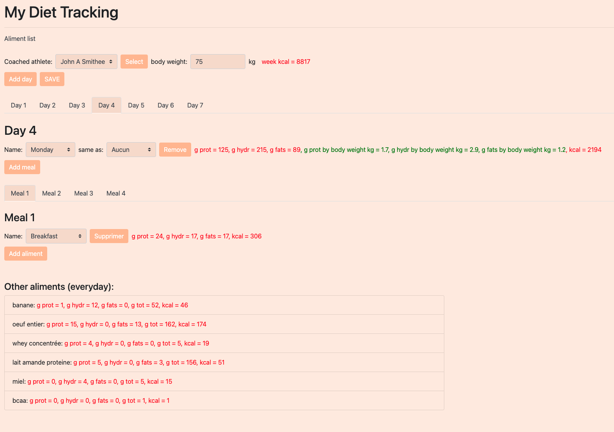
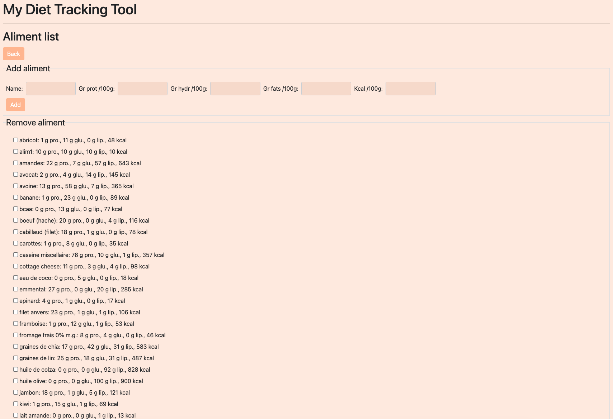
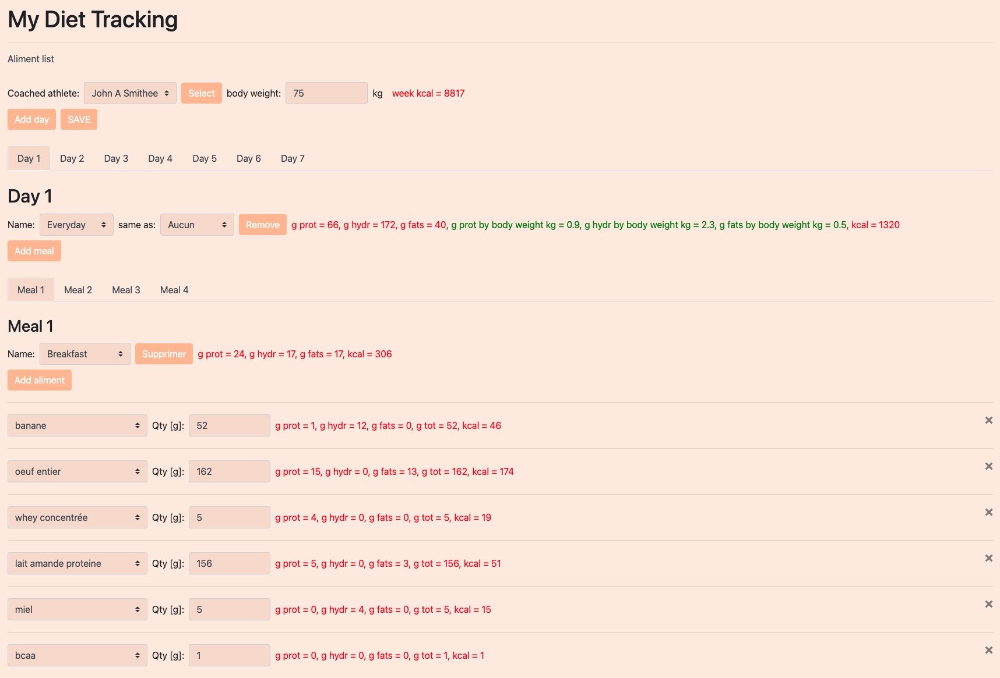

# 🥗 Diet Tracker PHP (Monolith Web App)

A lightweight **monolithic web application** to track calorie intake for athletes.

Built with:
- PHP (using **Symfony** framework)
- **Doctrine** ORM
- **Bootstrap** for styling
- **Docker** for containerized deployment

---

## 🧱 Architecture

This is a **monolith application** that serves both frontend and backend logic in one deployable unit. It returns dynamic HTML/CSS directly from the PHP backend.

- 📦 The **web app** runs in a Docker container with **Apache**
- 🗄️ The **MySQL database** (MariaDB) runs in a separate container
- 🔗 Communication happens over a Docker **bridge network**

---

## 🖼️ Screenshots

<p float="left">
  
</p>

<p float="left">
  
</p>

<p float="left">
  
</p>

---

## 🚀 Run Locally

To run the app using Docker:

```bash
# Build and run the MariaDB container
docker build --no-cache -t mariadb_image MySQL/
docker run -it -d --name maria_container -p 12345:3306 mariadb_image

# Build and run the PHP diet tracker container
docker build --no-cache -t diet_tracker_image Microservice/
docker run -it -d --name diet_tracker_container -p 8081:8000 diet_tracker_image
